# Description → model evaluation

24 of 24 descriptions produced a model; 24 are a single stud-connected assembly. Median shape match (soft IoU against the intent) 0.83. 0 cases lose at least one essential component at their build size. Surface fitting placed 429 slope, curve and cone elements; the median fractional surface match rose from 0.831 (cells) to 0.854 (cells and fitted elements).

**Protocol.** Descriptions and intents were written before the v2 engine existed. The intents are a stand-in for a language model: they were authored from the description and the published interpretation instructions only, and are frozen. Engine changes must not edit them; a failing case is a finding, not a fixture to repair. Interpreter: Claude (acting as the interpretation model in a development session, 2026-11-18). The descriptions, intents and results are in [the case file](data/intent-eval-v1.json) and [the results file](data/intent-eval-results-v1.json).

**What this does not show.** The interpreter was a single model acting under the published instructions; other models will write different intents. Shape IoU compares the voxel grid with the intent, not with the real object; a wrong intent can score well. Connectivity is nominal stud/receiver alignment. Clutch, strength and stability are not assessed. No physical build trial has been run on these models.

| Case | Category | Parts | Steps | Connected | Shape IoU | Real wheels | Roof slopes | Surface elements | Essential parts lost | Visible colour joints |
| --- | --- | ---: | ---: | --- | ---: | ---: | ---: | ---: | --- | ---: |
| [hatchback-car](eval/hatchback-car.png) | vehicle | 214 | 65 | yes | 0.94 | — | 6 | 11 | — | — |
| [cottage](eval/cottage.png) | architecture | 189 | 44 | yes | 0.92 | — | 59 | 8 | — | — |
| [high-wing-aeroplane](eval/high-wing-aeroplane.png) | vehicle | 52 | 29 | yes | 0.58 | — | — | 3 | — | — |
| [apple](eval/apple.png) | organic | 268 | 98 | yes | 0.88 | — | — | 30 | — | — |
| [kitchen-table](eval/kitchen-table.png) | furniture | 45 | 41 | yes | 0.55 | — | — | — | — | — |
| [double-decker-bus](eval/double-decker-bus.png) | vehicle | 144 | 40 | yes | 0.87 | 4 | — | — | — | — |
| [lighthouse](eval/lighthouse.png) | architecture | 109 | 43 | yes | 0.76 | — | — | 10 | — | — |
| [pine-tree](eval/pine-tree.png) | organic | 196 | 89 | yes | 0.82 | — | — | 22 | — | — |
| [rubber-duck](eval/rubber-duck.png) | organic | 221 | 61 | yes | 0.86 | — | — | 22 | — | — |
| [steam-locomotive](eval/steam-locomotive.png) | vehicle | 174 | 65 | yes | 0.72 | 8 | — | 18 | — | — |
| [sailing-dinghy](eval/sailing-dinghy.png) | vehicle | 88 | 59 | yes | 0.63 | — | — | 20 | — | 1 |
| [spotted-mushroom](eval/spotted-mushroom.png) | organic | 224 | 67 | yes | 0.87 | — | — | 16 | — | — |
| [park-bench](eval/park-bench.png) | furniture | 85 | 51 | yes | 0.43 | — | — | 8 | — | 1 |
| [rocket-on-pad](eval/rocket-on-pad.png) | vehicle | 46 | 23 | yes | 0.77 | — | — | 5 | — | — |
| [snowman](eval/snowman.png) | organic | 268 | 88 | yes | 0.85 | — | — | 27 | — | 2 |
| [castle-tower](eval/castle-tower.png) | architecture | 295 | 68 | yes | 0.87 | — | — | 26 | — | — |
| [desk-lamp](eval/desk-lamp.png) | household | 73 | 53 | yes | 0.70 | — | — | — | — | — |
| [farm-tractor](eval/farm-tractor.png) | vehicle | 378 | 156 | yes | 0.82 | — | — | 50 | — | 2 |
| [sitting-cat](eval/sitting-cat.png) | organic | 405 | 130 | yes | 0.87 | — | — | 51 | — | — |
| [garden-shed](eval/garden-shed.png) | architecture | 261 | 59 | yes | 0.96 | — | — | 15 | — | — |
| [two-seat-sofa](eval/two-seat-sofa.png) | furniture | 148 | 36 | yes | 0.93 | — | — | 17 | — | — |
| [coffee-mug](eval/coffee-mug.png) | household | 162 | 61 | yes | 0.64 | — | — | 10 | — | — |
| [windmill](eval/windmill.png) | architecture | 229 | 102 | yes | 0.79 | — | — | 21 | — | 1 |
| [elephant](eval/elephant.png) | organic | 333 | 111 | yes | 0.83 | — | — | 39 | — | — |

### hatchback-car

> A small red family hatchback car with four black wheels, a windscreen and side windows.

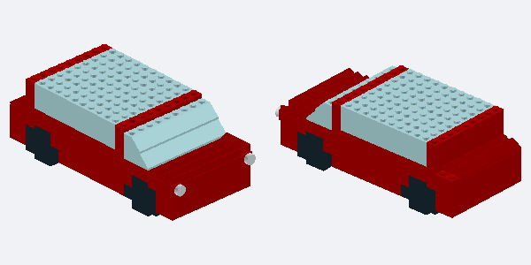

### cottage

> A cottage with white walls, a red pitched roof, a front door, two windows and a chimney.

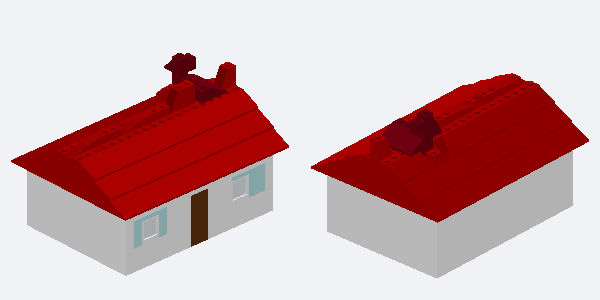

### high-wing-aeroplane

> A light propeller aeroplane, white with a blue stripe, high wings, a tail fin and fixed landing wheels.

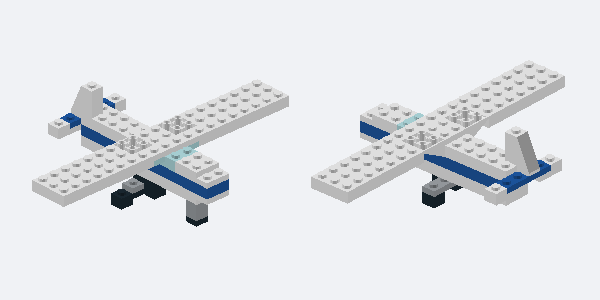

### apple

> A red apple with a short brown stalk and a green leaf.

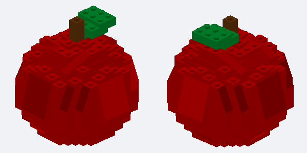

### kitchen-table

> A wooden kitchen table with four legs.

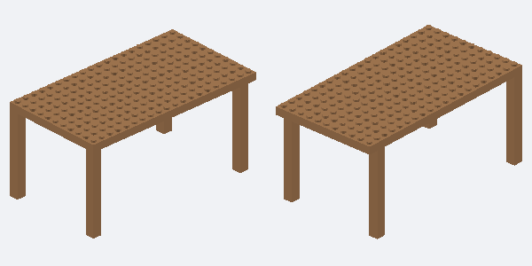

### double-decker-bus

> A classic red double-decker London bus.

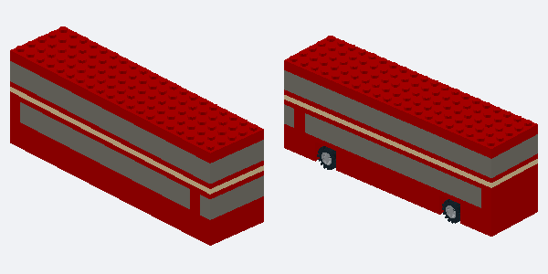

### lighthouse

> A lighthouse: a tall white tower with red stripes, a black lantern room with glass at the top, standing on a rocky grey base.

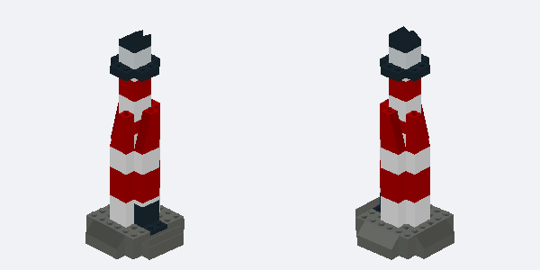

### pine-tree

> A green pine tree on a small grey base.

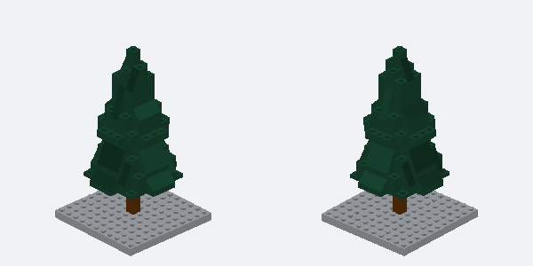

### rubber-duck

> A yellow rubber duck.

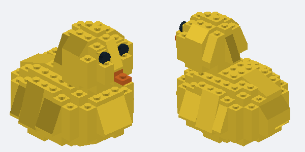

### steam-locomotive

> A black steam locomotive with red wheels, a tall chimney and a driver's cab at the back.

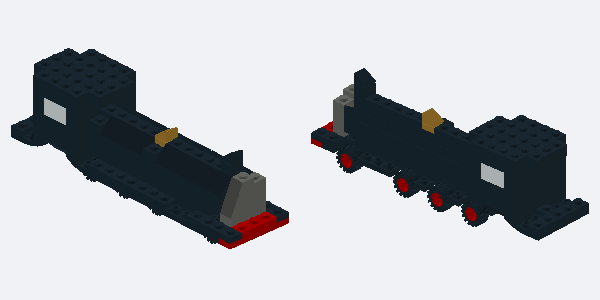

### sailing-dinghy

> A sailing boat with a white hull, a tall mast and a white sail.

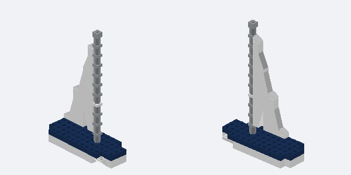

### spotted-mushroom

> A toadstool with a red cap covered in white spots and a thick white stem.

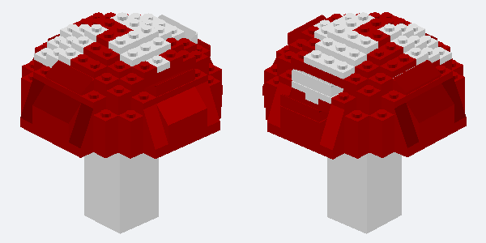

### park-bench

> A park bench made of brown wooden slats with black metal legs and armrests.

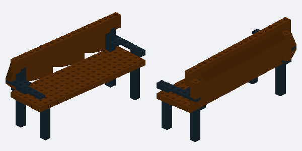

### rocket-on-pad

> A white rocket ship with red fins and a red nose cone, standing on a launch pad.

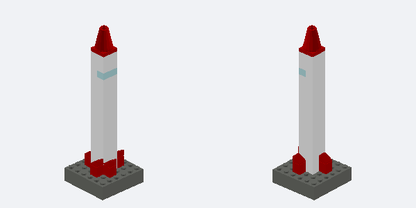

### snowman

> A snowman made of three snowballs, with a black top hat, a carrot nose and coal eyes.

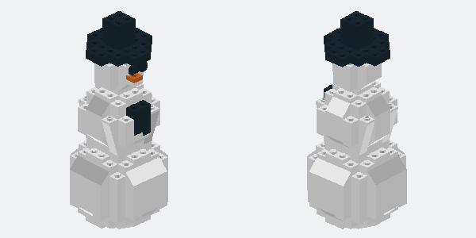

### castle-tower

> A square medieval castle tower in grey stone with battlements on top and an arched doorway.

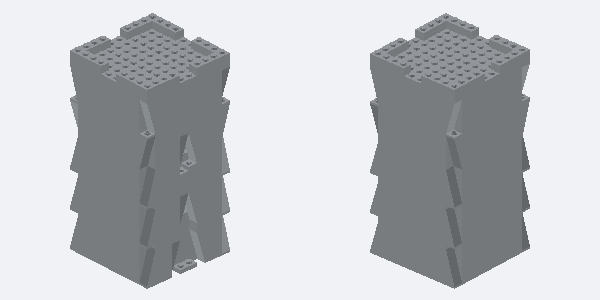

### desk-lamp

> An adjustable desk lamp with a round black base, an angled arm and a cone-shaped shade.

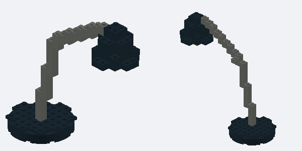

### farm-tractor

> A green farm tractor with big rear wheels, small front wheels and an enclosed cab.

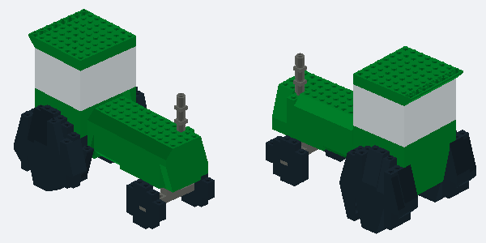

### sitting-cat

> A grey cat sitting upright with its tail curled around its feet.

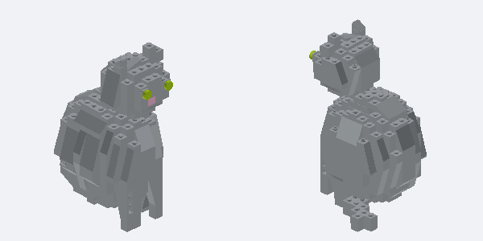

### garden-shed

> A garden shed with a green door and a single-pitch roof that slopes towards the back.

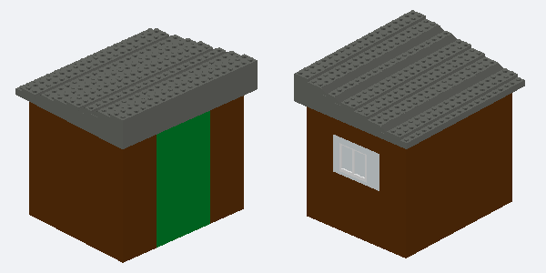

### two-seat-sofa

> A two-seater sofa in blue fabric with armrests and seat cushions.

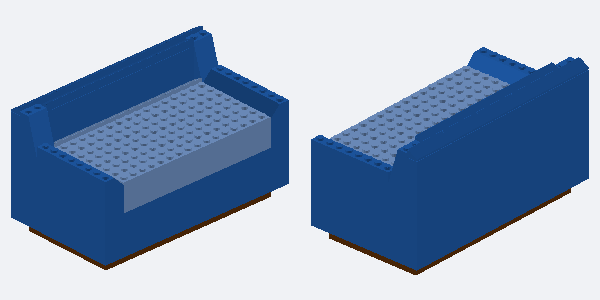

### coffee-mug

> A coffee mug with a handle.

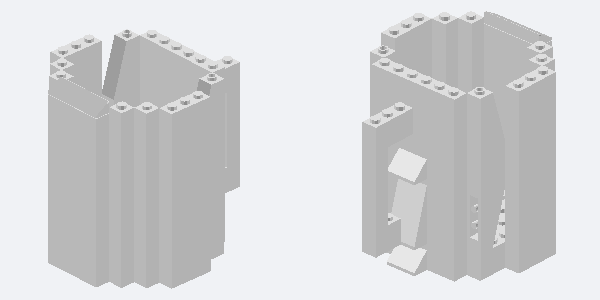

### windmill

> A traditional windmill with a tapered tower and four large sails.

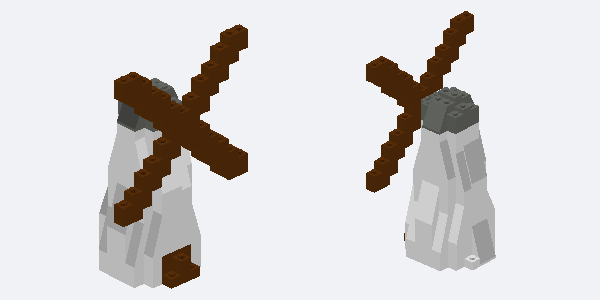

### elephant

> An elephant standing on four legs, with big ears, a long trunk and tusks.

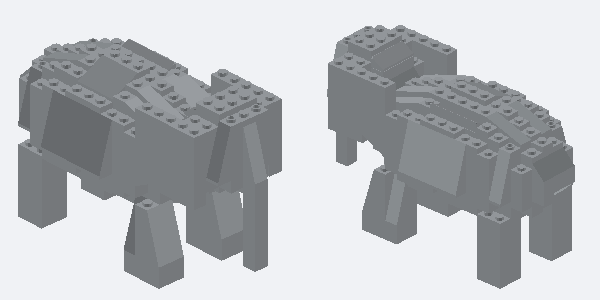

Reproduce with `node scripts/evaluate_intents.mjs --check`; refresh with `--write --images` after reviewing changes.
